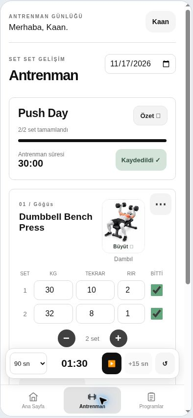
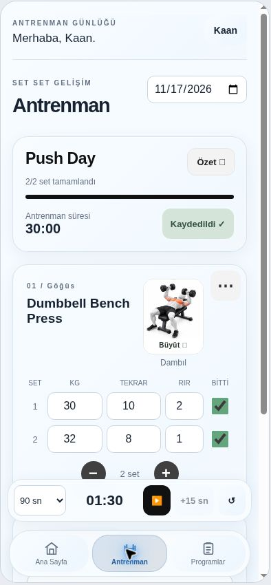
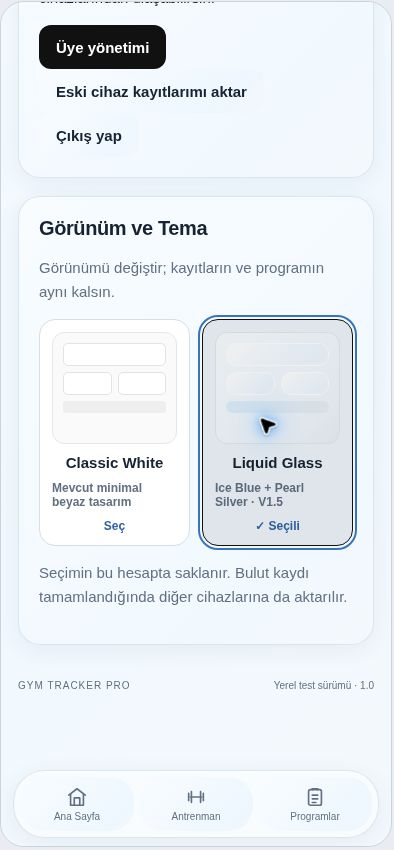

# Liquid Glass V1.5 — geliştirme ve test raporu

Tarih: 17 Kasım 2026. Dal: `feature/liquid-glass-v1-5`.
Temel commit: `435e87f` (Senin İçin V1 dahil güncel main).
Durum: Uygulama kodu ve yerel testler hazır. Canlıya alınmadı. Gerçek iPhone kabul testi bekliyor.

## İncelenen mimari

Uygulama framework kullanmayan HTML/CSS/JavaScript SPA. `auth-guard.js` kullanıcı ve profil rolünü doğruluyor, ardından `app.js` ve özellik dosyalarını yüklüyor. `render()` ekranları yeniden çiziyor. Hesap ekranı `settingsView()` içinde. Eski `currentTheme`, `chooseTheme`, `themePicker` noktaları devre dışıydı; bunlar kullanıldı.

`style.css` çok katmanlı minimal tema kuralları ve yüksek özgüllüklü bazı `!important` tanımları içeriyor. Classic görünümü değiştirmemek için bu dosyaya dokunulmadı. Yeni `themes.css` kök `data-theme` niteliğiyle sınırlı. İstisna: yeni tema seçicinin kendi stilleri iki temada da çalışıyor.

Mevcut `pwa-dock.js` yalnız iOS standalone modunda visualViewport ile menü ve sayacı konumlandırıyor; klavye açıldığında dock gizleniyor. Bu davranış değiştirilmedi; yeni CSS dock'un konumlandırma modelini koruyarak kapsül boşluğunu ve sayaç mesafesini ayarlıyor.

Depodaki diğer geliştirme dalları korundu. Başlangıçta çalışma dizini temizdi. Ana dal birleştirmesi, yayın veya veritabanı yazımı yapılmadı.

## Oluşturulan sistem

Hesap → Görünüm ve Tema içinde iki önizlemeli düğme, seçili durum işareti ve erişilebilir `aria-pressed` durumu var. Tema seçimi kök niteliği günceller; sayfa veya uygulama yeniden yüklenmez. Yalnız seçici düğmeler güncellendiği için odak, kaydırma, sayaç ve form DOM'u korunur.

| Özellik | Classic White | Liquid Glass |
|---|---|---|
| Varsayılan | Eski veya bilinmeyen tema değerleri bu görünümü kullanır | Açık seçim gerekir |
| Kartlar | Mevcut görünüm | 22 px köşe, yumuşak gölge, ince kenar |
| Renkler | Mevcut renkler | #F8FCFF / #DCEEFF / #E8EDF2; vurgu #397BC9 |
| Gradyan | Mevcut | 135°; dış %25, iç %35; son %20 Pearl bölgesi |
| Alt menü | Mevcut | Üç sekmeli floating kapsül, %95 yüzey, 20 px blur |
| Set girdileri | Mevcut | Beyaz, koyu metin; tamamlanma yeşili #78A68B korunur |
| Performans | Mevcut | Blur sadece küçük menü/sayaç yüzeylerinde |

Merkezi değişkenlerde renkler, gradyan yoğunluğu, açı, gölge ve köşe tanımlı. `color-mix` desteklenmediğinde sabit hesaplanmış renkler kullanılır. Reduced transparency veya reduced motion tercihinde ve blur desteklenmeyen tarayıcılarda opak yüzey kullanılır. Sürekli animasyon eklenmedi.

Ana Sayfa, antrenman, programlar, profil, diyaloglar, içerik/görev kartları ve iç Hacim Akışı kartları temaya bağlandı. İş mantığı, görev ödülleri ve veri modelleri değiştirilmedi.

## Kalıcılık ve Supabase

Yeni tablo veya migration yok. Tercih mevcut `state.settings.theme` alanında `classic-white` / `liquid-glass` olarak tutulur. Eski `light` gibi değerler silinmeden Classic olarak yorumlanır. Hesap bazlı mevcut `gym-tracker-pro-v1:<userId>` önbelleği kullanılır; ortak bir tema anahtarı yoktur.

`theme.js`, kimliği doğrulanmış kullanıcının yerel kaydını ekran görünür olmadan geri yükler. Çevrimdışı içerik girişinde de aynı adım çalışır. Bulut hidratasyonu sonunda uygulamanın normal `render()` akışı sunucudaki tercihi uygular. Mevcut Auth yükleme perdesi kaldırılmadı; Auth gecikmesi bu değişiklikle çözülmüş değildir.

Tema değişikliği mevcut `save()` kuyruğuna katılır. `gym_account_state.state` JSONB ve revizyon denetimli `save_gym_state` RPC kullanılır. Yerel bekleyen veri veya cihaz çakışması varsa mevcut koruma ve kullanıcıya inceleme akışı sürer. Bulut senkronizasyonu tamamlanmadan başka cihazda yeni tema görünmesi garanti edilmez. Geçersiz set veya açık program taslağı mevcut kayıt kuyruğunu geciktirebilir; tema yerelde uygulanmış kalır.

Canlı Supabase üzerinde yalnız salt okunur metadata sorguları yapıldı: `gym_account_state` için `member_id = auth.uid()` USING/WITH CHECK politikası ve `save_gym_state` fonksiyonunun security-invoker olduğu doğrulandı. Gerçek kullanıcı kaydı okunmadı/değiştirilmedi. Canlıya tema yazma testi yapılmadı.

## Dosyalar

- `app.js`: mevcut tema fonksiyonları ve Hesap seçicisi.
- `theme.js`: kök tema uygulama, hesap önbelleğinden geri yükleme, theme-color metası.
- `themes.css`: kapsamlandırılmış tema, seçici, menü ve erişilebilirlik alternatifleri.
- `index.html`: tema dosyalarının yüklenmesi.
- `auth-guard.js`: online/offline girişte hesap temasının geri yüklenmesi.
- `sw.js`: tema dosyalarının önbelleğe eklenmesi, cache sürümü v23.
- `package.json`: yeni tema testlerinin standart test komutuna eklenmesi.
- `tests/themes/theme.test.cjs`: kalıcılık, veri korunması, hesap izolasyonu, hata/çakışma testleri.
- `tests/themes/preview.html`, `mobile.html`: gerçek bileşenleri kullanan, yalnız sahte hesap/RPC ile çalışan yerel QA sayfaları. Canlı Supabase bağlantısı kurmaz.
- `docs/liquid-glass-v1-5/`: rapor ve üç ekran görüntüsü.

## Test sonuçları

| Kontrol | Sonuç |
|---|---|
| Mevcut ana test paketleri | 9/9 geçti |
| Görev/XP/metrics/client testleri | 35/35 geçti |
| Antrenman esnekliği ve RIR testleri | 10/10 geçti |
| Günlük içerik motoru/kaynak testleri | 9/9 geçti |
| Yeni tema testleri | 4/4 geçti |
| JS sözdizimi ve git diff whitespace | Geçti |
| Chrome mobil çerçeve: Hesap, Ana Sayfa, Antrenman, Programlar | Açıldı; tema değişimi görsel olarak kontrol edildi |
| Programlar: 320/375/390/430 px çerçeve | Belge genişliği ile kaydırma genişliği eşit; yatay taşma yok |
| Set ağırlığı 30→32 ve RIR 2→1 | UI'da düzenlendi; tema geçişi ve yenileme sonrası ağırlık 32 korundu |
| İkinci cihaz / offline yeniden deneme | Mock RPC ile geçti; gerçek canlı yazım testi değildir |
| Hesap ayrımı / bozuk ve engellenmiş storage | Otomatik test geçti |
| Eşzamanlı cihaz çakışması | Yerel veri korundu, eski revizyon reddedildi |
| Classic eski CSS'nin korunması | style.css değişmedi; geri geçiş görsel olarak kontrol edildi |

## Sınırlar ve kalan kabul kontrolleri

- Gerçek iPhone Safari, ana ekrana eklenmiş PWA, yazılım klavyesi ve safe-area donanım davranışı test edilmedi. Chrome iframe iPhone emülatörü değildir.
- WebKit ve gerçek PWA kapat/aç, soğuk çevrimdışı açılış testleri bu çalışma sırasında çalıştırılmadı. SW varlıkları güncellendi; gerçek cihaz kabulü gerekli.
- Classic görünümün piksel farkı otomasyonu yapılmadı.
- Günlük içerik, XP ve rol/atama mantığı otomatik test ve kod incelemesiyle kontrol edildi; gerçek koç/üye hesaplarıyla uçtan uca tema kabul testi yapılmadı.
- Her modal, program editörü ve tüm ekran durumları tek tek görsel olarak taranmadı.
- Yoğun/büyük antrenman kayıtlarında gerçek cihaz performans ölçümü yapılmadı.
- Önceden var olan bulut kayıt çakışmaları tema seçimiyle otomatik çözülmez; mevcut veri koruma akışı devam eder.

## Yayına alma ve devam noktası

1. Bu dalı main ile karşılaştır; başka çalışmalar geldi ise yalnız gerekli birleştirmeyi yap.
2. iPhone Safari ve standalone PWA'da iki tema, klavye, sayaç, kaydırma, çevrimdışı açılış, logout/login ve iki cihaz kontrolünü tamamla.
3. Kullanıcının açık yayın onayından sonra main'e birleştir ve GitHub Pages sonucunu doğrula.
4. Veritabanı migration adımı gerekmiyor. Yayın sonrası cache v23'ün etkinleştiğini kontrol et.
5. Geri dönüş için kullanıcı Classic seçebilir; teknik geri dönüş bu dalın kaynak değişikliklerini geri alan commit ile yapılabilir. Kullanıcı antrenman verileri geri alınmamalı.

Yeniden başlanırsa bu rapor, dal ve testler kontrol edilmeli. Tamamlanmış kodlama ve birim testleri gereksiz yere tekrarlanmamalı; kalan cihaz kabul kontrollerine odaklanılmalı.

## Ekran görüntüleri

Sahte test hesabı ve örnek antrenman verileridir; gerçek kullanıcı kaydı değildir.

